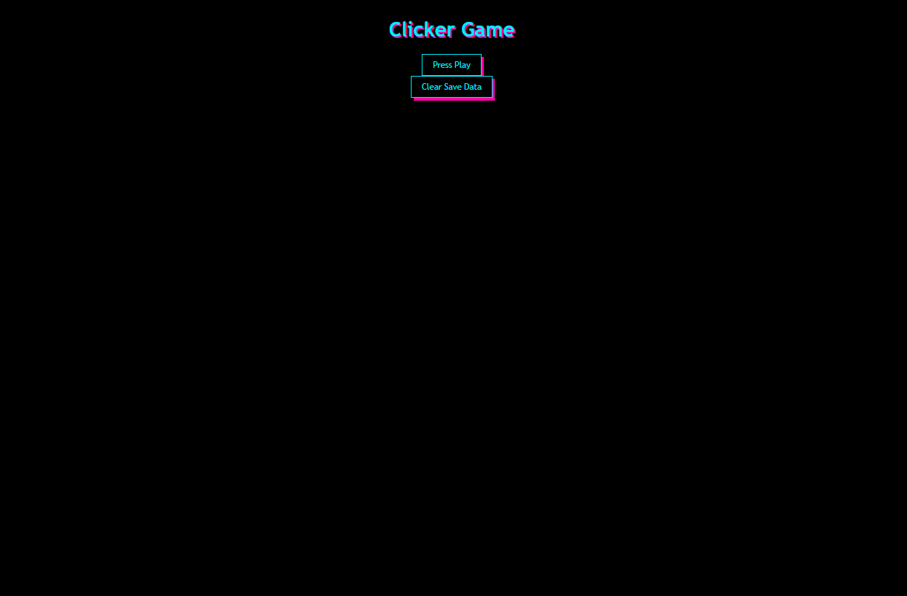
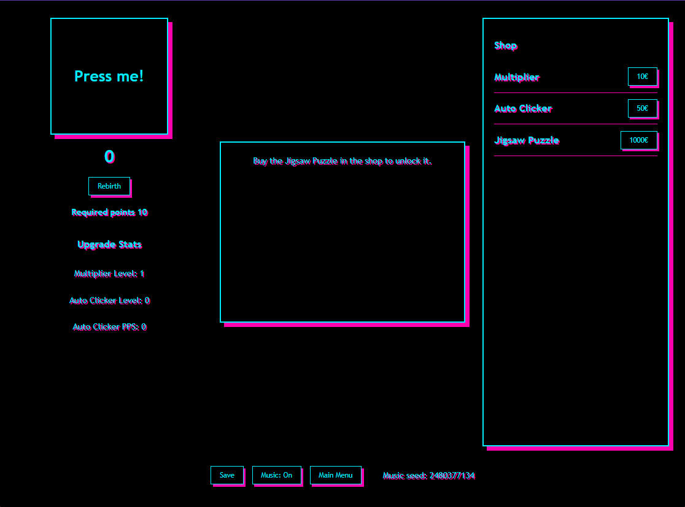

# Game name : Clicker Game

#### The game's Idea :

The game's idea is to click a button acrue points, use said points to purchase upgrades with which you can gain points more effectively.

#### Used technologies : 
##### React
##### JS
##### Tone.js

#### Installation guide:
It's a webpage, just download it and then go into the my-app folder inside of the downloaded folder
and then

#### Starting

Write npm run dev in the console inside the folder and then in a browser go to localhost:[the port here]

# Main menu

# Game

# Save data erasure

#### Game guide

Press the button to get points, purchase the upgrades, press the button some more, and eventually rebirth to have even higher of a starting points per click

You can use the arrow keys to move a virtual cursor and press enter to do a click, this is useful if you don't have a mouse, otherwise you can just use your mouse